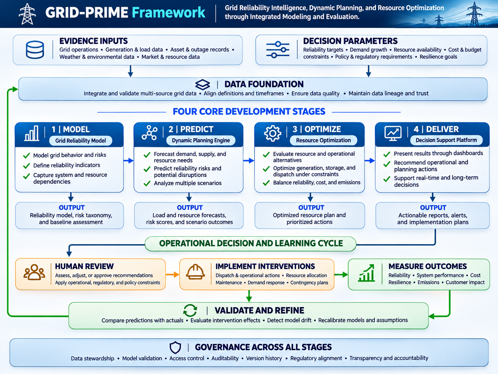
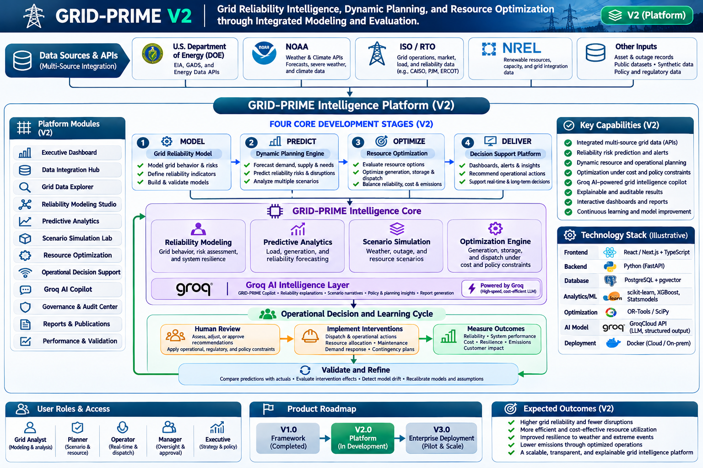

*TECHNICAL TRANSITION & PRODUCT DEVELOPMENT BLUEPRINT*

# GRID-PRIME

From V1.0 Research Framework to V2.0 Grid Intelligence Platform

Grid Reliability Intelligence, Dynamic Planning, and Resource Optimization through Integrated Modeling and Evaluation

Version 1.0  |  Prepared 17 November 2026  |  U.S. electric-grid modernization and resilience

The research case file in this repository is in [`web/`](web/).

### EXECUTIVE POSITION

This document preserves the four-stage GRID-PRIME framework and translates it into a practical, testable software-product blueprint. V1.0 is the conceptual and decision methodology; V2.0 is the proposed application layer that operationalizes its models, integrated data, scenario simulation, optimization, and accountable human decisions. The two accompanying diagrams are design artifacts, not evidence that an operational platform has been deployed.

### Document controls

| Item | Definition |
| --- | --- |
| V1.0 baseline | Approved GRID-PRIME four-stage framework visual supplied in the conversation |
| V2.0 baseline | Proposed GRID-PRIME Intelligence Platform visual supplied in the conversation |
| Intended readers | Researchers, grid-planning teams, utilities, system operators, developers, prospective pilot partners |
| Status | Transition and requirements blueprint; no claim of working software or grid outcomes |
| Evidence classification | Source-derived framework / externally verified data interface / proposed specification |

### Executive recommendations

- Preserve MODEL → PREDICT → OPTIMIZE → DELIVER as the canonical product lifecycle.

- Start the MVP with public datasets and synthetic grid scenarios; do not represent them as utility control-room telemetry.

- Implement deterministic reliability calculations and optimization outside the language model; use Groq for grounded interpretation.

- Require reproducible model runs, traceable data provenance, sensitivity tests, analyst approval, and explicit data licensing.

- Expand toward authenticated utility partnerships only after technical, cybersecurity, and operational validation.

## 1. V1.0 framework baseline

Figure 1 retains the enhanced original framework layout: evidence inputs and decision parameters feed a governed data foundation, then flow through four development stages into human-reviewed interventions, measured outcomes, and a validation-and-refinement loop.

*Figure 1. GRID-PRIME V1.0 framework: inputs, MODEL / PREDICT / OPTIMIZE / DELIVER stages, decision and learning loop, and governance.*

### 1.1 Canonical interpretation

MODEL captures grid behavior, vulnerabilities, reliability indicators, and resource dependencies. PREDICT produces load/resource forecasts, event probabilities, and scenario outcomes. OPTIMIZE compares feasible generation, storage, dispatch, and planning actions under reliability, cost, policy, and operational constraints. DELIVER presents recommendations, reports, alerts, and implementation plans for accountable human action.

## 2. V2.0 platform concept

Figure 2 demonstrates the envisioned product expansion. It adds public data connectors, operational modules, a predictive/optimization engine, a Groq-assisted interpretation layer, multi-role workflows, and a monitored decision cycle. All depicted functionalities are proposed product requirements until verified in code.

*Figure 2. GRID-PRIME V2.0 product concept: official data sources, planned modules, intelligence core, Groq AI, monitoring, roles, and roadmap.*

### 2.1 Definition of the V2 product

GRID-PRIME V2 is a modular analytical decision-support system for grid reliability and infrastructure/resource planning. Its first release should provide public-data research, reproducible network and resource simulations, ranking of interventions, and source-grounded explanatory reports. It must not be characterized as SCADA, EMS, a live dispatch authority, or a certified reliability assessment tool.

## 3. Transition thesis and capability mapping

| V1.0 framework element | V2.0 functional component | Required deliverable |
| --- | --- | --- |
| Evidence inputs | Connectors + data registry | EIA, weather, grid-market and renewable-resource feeds; local files |
| Decision parameters | Scenario/constraint editor | Reliability target, reserve margin, budgets, operating limits, policy assumptions |
| Data foundation | ETL and data-quality service | Canonical units, UTC time alignment, lineage, versioned datasets |
| MODEL | Reliability Modeling Studio | Risk taxonomy, baseline topology and capacity models |
| PREDICT | Forecast and Scenario Lab | Demand, supply and outage forecasts with prediction intervals |
| OPTIMIZE | Optimization Workbench | Ranked intervention portfolios with feasibility certificates |
| DELIVER | Decision Support Workspace | Dashboards, explanation, alternatives, action records |
| Human review | Role-based review gates | Approval, adjustment, rejection, rationale and reviewer identity |
| Implement interventions | Action tracker / pilot link | Owner, due date, action type, progress, decision linkage |
| Measure outcomes | Performance Lab | Forecast residuals, scenario evaluation and decision-outcome metrics |
| Validate & refine | Model registry and feedback | Drift detection, reruns, versioned assumptions |
| Governance | Audit/security controls | Access policy, evidence trace, change log, human accountability |

### 3.1 What remains unchanged

The V1 four-stage logic, output-per-stage pattern, end-to-end human oversight, measurable operational learning cycle, and cross-stage governance remain normative. V2 adds the software mechanics required to execute and audit the method; it does not replace the underlying conceptual framework.

### 3.2 What changes materially

V2 introduces API/CSV acquisition; spatial and time-series data harmonization; computational models; automated scenario execution; comparative optimization; visual decision support; a Groq-based research copilot; and controlled workflows. Claims of greater reliability, resilience, cost reduction, or emissions performance remain hypotheses until supported by benchmark or pilot evidence.

## 4. Data and API integration strategy

The sources below are practical candidates, not guaranteed unrestricted access. Every connector must be checked for account requirements, allowed redistribution, historical completeness, licensing, and coverage. Grid-operation data often vary by balancing authority and ISO/RTO.

| Source / interface | Proposed use | Access / diligence |
| --- | --- | --- |
| EIA API v2 (eia.gov/opendata) | Electricity sales, generation, fuel, demand and regional indicators | Official REST API; dataset-specific cadence and coverage; API key policies |
| NOAA Climate Data / NWS APIs | Weather observations, severe weather, alerts and resilience scenarios | Public sources; endpoints, user-agent and rate rules vary |
| PJM Data Miner 2 | Market/operation time series, load, prices and system conditions | Account/API access; significant redistribution restrictions |
| ERCOT Public API | Texas market/load and operational public reports | Registration/authentication requirements; endpoint-specific documentation |
| NLR/NREL developer datasets | Solar production/resource potential; technology and scenario inputs | PVWatts and NSRDB methods; API keys, coverage and usage conditions |
| FERC / NERC publications | Policy, reliability standards and benchmark context | Public reports, not one uniform operational API |
| Synthetic network and asset data | Feeder/substation contingencies, failure scenarios, intervention prototyping | Flag explicitly as simulated, seeded and nonoperational |

### 4.1 Public data is not the same as physical-system observability

EIA and regional operator feeds do not ordinarily expose complete utility asset health, network topology, relay settings, feeder protection coordination, or private dispatch schedules. V2 should track source fidelity at each analytical level: national/regional aggregate, balancing-authority/market, or permitted utility asset data. Do not infer asset-level reliability from national aggregate indicators.

### 4.2 Ingestion contract

Each adapter should emit: source_id, dataset_id, observation_timestamp_utc, ingestion_timestamp_utc, region, spatial_resolution, units, value, status, licensing_class, version/hash, quality_flags, and raw_source_pointer. Quality checks include freshness, duplicate keys, unit conversion, outliers, time-zone normalization, missingness, and cross-series plausibility.

## 5. Proposed twelve-module product architecture

| No. | Module | User-facing objective |
| --- | --- | --- |
| 01 | Executive Reliability Dashboard | View KPI trends, risk outlook and intervention status |
| 02 | Data Integration Hub | Manage connectors, credentials, uploads and refresh jobs |
| 03 | Grid Data Explorer | Search, filter, map and compare sourced grid observations |
| 04 | Reliability Modeling Studio | Define system abstractions, exposure indicators and contingencies |
| 05 | Predictive Analytics | Produce load, generation, outage and risk forecasts |
| 06 | Scenario Simulation Lab | Run severe-weather, peak-demand and resource-availability scenarios |
| 07 | Resource Optimization | Build resource/intervention portfolios subject to constraints |
| 08 | Operational Decision Support | Compare choices, assumptions, trade-offs and approvals |
| 09 | Groq AI Copilot | Explain model results and summarize retrieved technical evidence |
| 10 | Governance and Audit Center | Manage permissions, decision trails and model approvals |
| 11 | Reports and Publications | Export technical briefs, scenario reports and evidence packs |
| 12 | Performance and Validation Lab | Backtest forecasts, benchmark optimization and monitor drift |

### 5.1 Primary journeys

- Research analyst: select region and date → inspect source provenance → establish baseline → run forecast → interpret confidence intervals → export cited report.

- Planning engineer: define network abstraction and contingency → select candidate resources → set cost/reliability constraints → optimize → compare trade-offs → request review.

- Reviewer: examine source quality, model version, assumptions and feasible alternatives → approve or return → record rationale.

- Program manager: monitor accepted actions and outcome measures → trigger retrospective validation and model reassessment.

### 5.2 Initial data classes

Organization; User; Role; DataSource; DatasetVersion; Location; Asset (optional/authorized); NetworkModel; ReliabilityIndicator; Scenario; ScenarioInput; ForecastRun; RiskEstimate; ResourceOption; OptimizationRun; Recommendation; ReviewDecision; Intervention; OutcomeObservation; ModelVersion; AuditEvent; ReportArtifact.

## 6. Analytical models, assumptions and mathematics

### 6.1 Forecasting

Demand and supply series may be modeled using benchmark methods (seasonal naive, exponential smoothing), SARIMAX/gradient boosted trees, or other validated approaches. Training must respect chronological splits and avoid using future-known information. Output: point forecasts, calibrated intervals, and provenance.

Example demand formulation: D̂(t+h) = f(D(t−k:t), weather, calendar, region, demand drivers; θ). Report MAPE only where values and denominator make it meaningful; also use MAE, RMSE, and prediction interval coverage.

### 6.2 Reliability and risk assessment

Define an event-level risk measure R_i = P_i × C_i, where P_i is a calibrated event probability and C_i is an explicitly defined consequence measure (e.g., unserved energy, customers affected, downtime, or estimated cost). This simplified score is illustrative; report uncertainties and avoid collapsing incompatible consequences into one opaque total.

Where source quality permits, estimate expected energy not served (EENS), loss of load expectation (LOLE), and scenario-based unserved energy. Appropriate metrics depend on network representation and data sufficiency. Do not treat the model as a utility-certified adequacy study without validation.

### 6.3 Intervention optimization

Illustrative objective: minimize Σ_i c_i x_i + λ Σ_s p_s U_s(x), subject to Σ_i c_i x_i ≤ B, x_i ∈ {0,1}, resource availability and grid operating constraints. Here x_i indicates intervention selection, c_i cost, B budget, p_s scenario likelihood, and U_s unserved-energy or service-loss proxy. Extend to multi-objective Pareto frontiers for reliability, cost, emissions, and equity.

### 6.4 Explainability and sensitivity

Every result must retain units, time horizon, scenario definition, model version, constraints, data source, confidence level, and alternative ranking. Include parameter sweeps for demand growth, event frequency, fuel prices, maintenance windows, and available resources.

### 6.5 Interpretation boundaries

Forecasted load is not a demonstrated transmission constraint; historical price spikes are not equivalent to verified equipment failures; a simulation is not evidence of real outages avoided. V2 outputs must clearly identify data granularity and inferred versus observed quantities.

## 7. Groq AI: capability, security and control boundaries

GroqCloud is proposed as the LLM inference service for natural-language interpretation of approved analytics. GRID-PRIME should implement a server-side gateway that constructs evidence-grounded prompts and exposes only explicitly whitelisted read-only data tools. No automatic grid control, switching, dispatch, or emergency instructions are authorized through the LLM.

| Feature | Technical pattern | Guardrail |
| --- | --- | --- |
| Source-grounded Q&A | RAG over official documentation and curated dataset metadata | Answers cite source IDs, dates and retrieval versions |
| Forecast interpretation | Pass structured model metrics/results to Groq | Model computes numbers; LLM only explains |
| Scenario brief | Groq summarizes alternatives and uncertainty | No unsupported operational certainty |
| Research/report drafts | JSON-schema output + deterministic report template | Human approval before publication |
| Tool-assisted queries | Whitelisted service endpoints; logged invocation | Read-only in MVP; limit scope and rate |
| Failure and abstention | Timeout, retries, unavailable-data response | No fabricated values or silent replacement |

### 7.1 Data handling

Never send credentials, critical infrastructure sensitive information, protected security configurations, or unauthorized operator data to an external model. Define a data-classification policy, redact and minimize input, use contractual and security review, log disclosure approvals, and retain the ability to disable external LLM calls. A privacy claim about one provider does not by itself satisfy utility or agency security requirements.

### 7.2 Model validation

Prompt output schemas are necessary but not sufficient: syntactically valid JSON does not guarantee correct engineering claims. Test citation faithfulness, numerical consistency, abstention, prompt-injection resistance, and error-handling. Freeze model IDs in deployment configurations and retest when providers change models.

## 8. System architecture and technology stack

| Layer | Recommended implementation | Why |
| --- | --- | --- |
| Web experience | React/Next.js + TypeScript; Tailwind; maps and charts | Reusable dashboards and workflows |
| Application API | FastAPI + Pydantic | Typed analytics/services and validation |
| Data persistence | PostgreSQL + PostGIS; object storage | Time-series metadata, geography and reproducibility |
| Data pipelines | Python; scheduled workers/queues | Versioned ingestion and retries |
| Modeling | Statsmodels, scikit-learn, XGBoost | Benchmarked, reproducible prediction |
| Optimization | Pyomo or OR-Tools / SciPy | Constraint formulation, solvers and scenario portfolios |
| Grid simulation | pandapower / PyPSA / GridLAB-D as appropriate | Power flow or network planning in validated domain |
| AI orchestration | Groq API behind server gateway; retrieval controls | Source-linked explanatory interaction |
| Security | OIDC auth, RBAC/ABAC, encryption, audit logging | Protected workflows and traceability |
| Delivery | Docker, CI, infrastructure-as-code | Repeatability, releases and environment separation |

### 8.1 Execution boundaries

Public connectors ingest asynchronously; canonical observations are stored with versioned metadata; model and optimization jobs run independently in managed workers; user-facing dashboards read only validated artifacts; Groq retrieves preapproved results and citations; an authorized reviewer records final recommendations. This separation limits model hallucination and enables numerical regression tests.

### 8.2 Suggested API endpoints

| Endpoint | Purpose |
| --- | --- |
| GET /v2/sources | List connectors and licensing classes |
| POST /v2/ingestion-runs | Start ingestion under allowed credential/scope |
| GET /v2/datasets/{id}/versions | Inspect freshness, provenance and schema |
| POST /v2/scenarios | Create versioned scenario/constraints |
| POST /v2/forecast-runs | Run validated forecast job |
| POST /v2/optimization-runs | Run constrained intervention comparison |
| GET /v2/runs/{id}/results | Retrieve metrics, confidence and artifacts |
| POST /v2/reviews | Record analyst decision and rationale |
| POST /v2/ai/explain | Request controlled Groq explanation |
| GET /v2/audit-events | Retrieve role-scoped activity trail |

## 9. Experimental validation and evaluation protocol

### 9.1 Verification tiers

1. Unit and contract tests: ingestion schema, role permissions, deterministic metric calculations and reproducible solver outputs.

1. Historical backtesting: rolling-origin load and generation forecasts; compare to naive and seasonal baselines.

1. Scenario plausibility: validated constraints, realistic resource limits, and power-flow feasibility when a network model is available.

1. Human evaluation: blind expert reviews for relevance, usability, and actionability of scenario comparisons and LLM summaries.

1. Security/operations: penetration review, dependency scans, injection tests, secret handling, load tests, recovery and audit completeness.

### 9.2 Proposed acceptance metrics (targets, not results)

| Metric | Proposed target / gate |
| --- | --- |
| Source provenance completeness | 100% of model outputs have dataset version and timestamp |
| Connector reliability | ≥ 99% successful scheduled jobs in controlled staging test |
| Forecast accuracy | Improvement against prespecified seasonal-naive baseline or documented reason for failure |
| Interval calibration | Report nominal vs observed interval coverage across rolling folds |
| Optimization feasibility | 100% suggested portfolios satisfy all encoded hard constraints |
| Decision traceability | 100% reviewed recommendations link assumptions, model and reviewer |
| AI source grounding | ≥ 95% supported claims on expert-audited evaluation set; abstain when absent |
| Role enforcement | No unauthorized write action in negative authorization tests |
| Run reproducibility | Identical seeded runs and pinned versions reproduce within declared tolerances |

### 9.3 Failure cases to report

Missing ISO data, anomalous telemetry, geographic mismatches, weather extremes outside training support, model calibration error, infeasible optimization, conflicting objectives, solver timeout, stale data, prompt injection, and misleading citations. Treat these as first-class results, not details to omit from a publication.

## 10. Implementation roadmap and institutional adoption

| Phase | Scope | Exit evidence |
| --- | --- | --- |
| P0  \|  Definition | Requirements, domain model, classifications, data licensing, baseline UI | Approved architecture, data contracts and use cases |
| P1  \|  Data foundation | EIA/NOAA + one permitted regional connector; harmonized warehouse | Repeatable ingestion, quality dashboards and versioning |
| P2  \|  Model + predict | Baseline reliability indicators, forecasting, scenario engine | Rolling backtests and documented assumptions |
| P3  \|  Optimize + deliver | Portfolio solver, dashboards, human review and report export | Feasibility tests, decision traceability and demos |
| P4  \|  Groq + validation | Source-grounded copilot, QA, security and usability evaluation | Expert review; adversarial AI tests; reproducible benchmark |
| P5  \|  Controlled pilot | Approved utility or research partner with defined noncritical use | Pilot protocol, permissible data access, comparison baseline, findings |

### 10.1 Candidate stakeholders

Potential collaborators include university power systems laboratories, utility planning departments, independent system operators/regional transmission organizations, public utility commissions, state energy offices, DOE-affiliated research groups, and industry associations. Their inclusion is a potential engagement pathway and does not imply endorsement, partnership, or system access.

### 10.2 Pilot proposal

A credible 60–90-day demonstration could target one geography and one explicit analytical problem, such as short-horizon regional load forecasting with weather scenarios and resource-portfolio ranking. The pilot should preregister baselines, define permissible datasets, benchmark accuracy and solve time, and obtain independent qualitative review. Avoid live operational intervention unless separately approved and independently safety-assessed.

### 10.3 Risks and mitigations

| Risk | Mitigation |
| --- | --- |
| Incomplete topology/asset data | Use labeled abstraction; do not claim asset-level accuracy |
| API changes and redistribution limits | Adapter tests; licensing register; permitted exports only |
| Nonstationary demand and extremes | Drift tests; stress scenarios; retraining controls |
| Optimization infeasibility | Infeasibility explanations, soft-constraint review, fallback |
| LLM hallucinations | Source-grounded tools, validation, abstention, human review |
| Security-sensitive infrastructure data | Classification controls, least privilege, no unauthorized external transmission |
| Misleading outcomes claims | Pre-registered studies and reporting of uncertainty |

## 11. Development deliverables and documentation pack

- Product Requirements Document: roles, 12 modules, screens, use cases, state transitions and acceptance tests.

- System Design Specification: architecture, deployment boundaries, database schema, APIs, error handling, telemetry and security.

- Data Governance and Connector Register: source terms, geography, refresh cadence, quality rules, provenance and retention.

- Model Methodology Paper: datasets, feature design, benchmarks, metrics, calibration, sensitivity and bias analysis.

- Optimization and Decision Logic Specification: variables, objectives, constraints, feasibility, edge cases and scenario comparisons.

- Groq AI Operations Plan: model selection, RAG, prompts, schemas, logging, redaction, evaluation and vendor dependencies.

- Pilot and Evaluation Protocol: governance approval, reproducible study design, reviewer rubric and statistical analysis.

- Deployment Runbook: secrets, monitoring, backups, incident management, restore testing and change control.

### 11.1 Release conditions

V2 should not be publicly described as deployed, technically validated, or capable of preventing outages until executable artifacts, reproducible test logs, and deployment/pilot evidence substantiate those statements. Public demonstrations should use named public datasets and clearly marked simulation records. Product and research documentation should distinguish measured outcomes from anticipated benefits.

## 12. Conclusion and recommended next steps

GRID-PRIME’s continuity is its strongest design feature: a stable four-stage decision framework becomes a product architecture without losing source lineage, engineering interpretation, human accountability, and learning from actual outcomes. The product’s technical value must be demonstrated through data quality, forecast calibration, constrained optimization, independent review, and traceable decisions rather than by AI branding or diagram complexity.

Recommended immediate execution order: (1) approve this architecture baseline and select the initial geography/use case; (2) write a screen-level PRD and domain schema; (3) implement ingestion and provenance; (4) build baseline prediction and constrained optimization; (5) add Groq interpretive workflows; (6) benchmark and document results.

## References and official technical sources

U.S. Energy Information Administration, API v2 documentation — https://www.eia.gov/opendata/documentation.php

PJM, Data Miner 2.0, APIs, access and redistribution conditions — https://www.pjm.com/markets-and-operations/etools/data-miner-2/

ERCOT, Public API Applications and developer portal — https://www.ercot.com/services/mdt/data-portal

NOAA National Weather Service, API documentation — https://www.weather.gov/documentation/services-web-api

NOAA Climate Data Online, web services — https://www.ncei.noaa.gov/support/access-data-service-api-user-documentation

National Laboratory of the Rockies (formerly NREL), developer solar APIs — https://developer.nlr.gov/docs/solar/

GroqCloud, Structured Outputs — https://console.groq.com/docs/structured-outputs

GroqCloud, Tool Use Overview — https://console.groq.com/docs/tool-use/overview

FERC, electric industry information — https://www.ferc.gov/industries-data/electric

NERC, Reliability Assessments — https://www.nerc.com/pa/RAPA/ra/Pages/default.aspx

Source note: Figures 1 and 2 reproduce the user-provided GRID-PRIME visuals. Diagram capabilities are conceptual until implemented and verified. Service integration was not tested.
